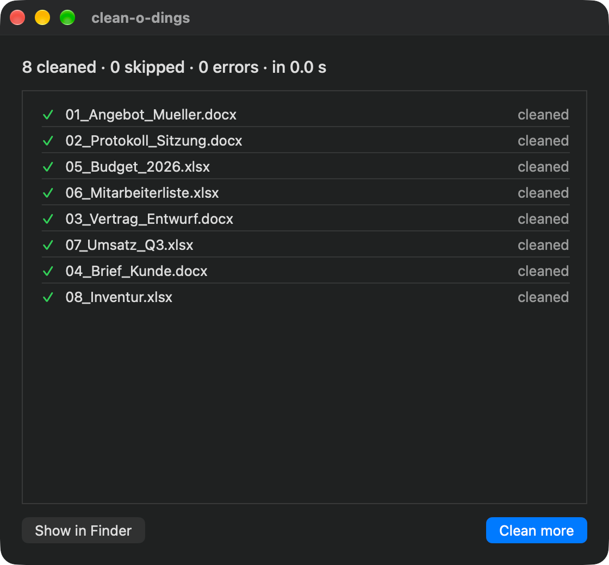
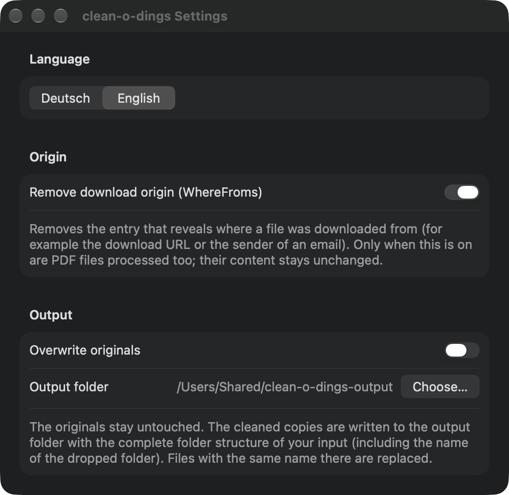

  

# clean-o-dings

[English](README.md) · [Deutsch](README.de.md)

A small macOS app that removes personal metadata from Word, Excel and PowerPoint files, and the download origin from PDFs, before you share them. Content, dates, titles and statistics stay untouched.

  

## Download

**[Download the latest release](https://github.com/fstk/clean-o-dings/releases/latest)** and unzip `clean-o-dings-beta-*.zip`.

Requires macOS 26 or later on Apple Silicon. The app is currently in beta.

## What gets removed

| Part of the file | Fields |
|---|---|
| `docProps/core.xml` | Author (`dc:creator`), Last modified by (`cp:lastModifiedBy`) |
| `docProps/app.xml` | `Manager`, `Company`, `LastAuthor` |
| File system | Download origin (extended attribute `com.apple.metadata:kMDItemWhereFroms`, set by browsers and mail) |

Everything else in the file stays byte-for-byte identical, including created and modified dates. The download origin is not part of the file itself, it is stored by macOS next to it.

Supported formats: `.docx .docm .dotx .dotm .xlsx .xlsm .xltx .xltm .pptx .pptm .potx .potm`. The old binary formats (`.doc`, `.xls`, `.ppt`) are not supported.

**PDF** files are accepted too, but only the download origin is removed. The PDF itself stays byte-for-byte identical. Metadata inside the PDF (author, producer) is not removed yet.

## Usage

Drop files or folders onto the window or the Dock icon, or choose them with “Choose files…” (⌘O). Folders are searched recursively. The app shows one line per file: cleaned, skipped or error. An error never stops the rest of the batch.

## Settings

Open the settings with **⌘,**. Changes take effect immediately.

  

| Setting | What it does |
|---|---|
| **Language** | Switches the app between German and English. By default it follows your system language. |
| **Remove download origin (WhereFroms)** | On by default. Removes the entry that browsers and mail attach to downloaded files and that reveals where they came from, for example the download URL or the sender of an email. Only when this is on are PDF files processed; their content stays byte-for-byte unchanged. |
| **Overwrite originals** | On by default: the cleaned files replace the originals directly, there is no backup. Off: the originals stay untouched and the cleaned copies are written to the output folder (the screenshot shows this state). |
| **Output folder** | Only shown when “Overwrite originals” is off. Click “Choose…” to pick a folder. The copies keep the complete folder structure of your input, including the name of a dropped folder: dropping `Project` creates `<output folder>/Project/…`. PDFs are copied there too, without their download origin. Files with the same name in the output folder are replaced. If the folder no longer exists, the app asks you to choose a new one. |

Only these settings are stored, locally on your Mac: language, origin setting, overwrite setting and the path of the output folder.

## Installation

1. Unzip the download and move `clean-o-dings.app` to your Applications folder.
2. The app is signed with a Developer ID and notarized by Apple, so it opens like any other app. On first launch macOS asks you to confirm that it was downloaded from the internet.

## Privacy

clean-o-dings runs in the macOS App Sandbox and has no network access. It only reads and writes the files and folders you give it. The only things it stores are the language, the origin setting, the overwrite setting and the path of your output folder.

## License

[MIT](LICENSE)
